# Plasmonic-Enhanced Laser-Induced Sonofusion

### Overcoming the Temperature Barrier via Resonant Nanoparticle Heating

**An eight-stage mathematical and computational investigation of acoustic bubble collapse, gold-nanoparticle photothermal heating, and the physical feasibility of extreme gas temperatures.**

**Researcher:** Dimitri Bolt · **Academic supervisor:** Prof. Dr. Ildar R. Gabitov  
**Program:** Mini-Research 1–8 · **Status:** Completed and independently reviewed (2026)  
**Scope:** The numerical research program is complete; *thermonuclear fusion and a physically attainable universal maximum temperature have not been demonstrated.*

> **The central finding:** A coupled, reduced laser–gold–water–bubble model was built and numerically verified. For its specified nominal *single-nanoparticle* configuration, the change in peak gas temperature is only **+1.408816 µK** at 1.00 bar and **+2.184879 µK** at 1.15 bar. The first is conditional on unverified particle confinement; the second is a **physically formal** calculation despite numerical completion. Stronger and rarer extreme states remain scientifically unresolved—not proven impossible.

**Start here:** [**Consolidated Final Scientific Report (PDF)**](Final_Report/Consolidated_Final_Scientific_Report.pdf) · [**MR8 Technical Report (PDF)**](Mini_Research/08_Physical_Feasibility/report/08_Physical_Feasibility.pdf) · [Original research plan](Plasma-plan.tex) · [All eight studies](#the-eight-mini-research-studies) · [Reproduction guide](#reproducing-the-results)

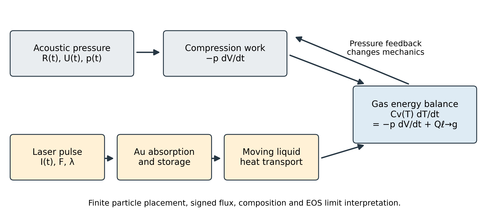

*Figure: the actual model architecture. Acoustic compression and optical absorption meet through gold storage, heat transport in the liquid, a signed gas–liquid boundary flux, and feedback from gas pressure. The laser is **not** modeled as heating the gas instantaneously.*

---

## 1. Why this project?

An acoustically driven gas bubble expands and collapses in a liquid. Compression can greatly raise its internal gas temperature, but predictions of extreme temperatures depend on liquid compressibility, heat exchange, water vapor, chemical and phase changes, and the validity of the gas equation of state.

Gold nanoparticles (AuNPs) absorb light efficiently near plasmonic resonances. This motivates a more specific question than merely asking whether a powerful laser can heat gold:

**Can laser energy absorbed by AuNPs cross the surrounding water and the bubble interface at the right time to increase the gas temperature during a strong collapse—and could any physically credible configuration approach thermonuclear conditions?**

The work addressed three objectives:

1. **Acoustic baseline:** derive and numerically solve bubble dynamics and gas heating **without a laser**, identifying where standard models become unreliable.
2. **Plasmonic extension:** model optical absorption, AuNP heating, heat transfer into water and the bubble, and gas-pressure feedback in a coupled dynamical system.
3. **Extreme-state feasibility:** examine both ordinary and potentially rare/extreme scenarios, separate numerical results from physical evidence, and determine what can—and cannot—be concluded about fusion.

These are *modeling and feasibility* objectives, not a claim that fusion has been produced.

## 2. How the model works

The reference calculations use a spherical bubble of initial radius **6 µm** in water, driven at **30 kHz**. Acoustic pressure is prescribed by

$$
p_\infty(t)=p_0-P_a\sin(2\pi f t).
$$

The model develops in stages:

- **Bubble motion:** Rayleigh–Plesset (RP), followed by the first-order compressible Keller–Miksis (KM) formulation and a bounded Gilmore–Tait liquid-model comparison.
- **Gas physics:** compression work, signed heat exchange, variable species heat capacity, a fixed water-vapor inventory, and explicit checks of the limitations of ideal/frozen-composition assumptions.
- **Optical physics:** measured Johnson–Christy gold optical constants, dipole/Mie cross sections, absorption versus scattering, and finite laser-energy budgets.
- **Thermal coupling:** a resolved finite-particle *stationary* problem (MR6), then a *moving radial, angularly averaged* liquid model with dynamic gold storage, an interfacial heat flux and mechanical feedback (MR7).

For a fixed gas inventory, the gas-energy equation is

$$
\dot U_g=-p_g\dot V+Q_{\ell\to g},
\qquad V=\frac{4\pi R^3}{3},
$$

where **positive** \(Q_{\ell\to g}\) represents heat entering the gas. Optical heating first enters the AuNP through \(P_{\mathrm{abs}}(t)=I(t)\sigma_{\mathrm{abs}}\); it must then pass through the liquid before it can affect the gas. The coupled calculations evolve the current gas pressure rather than assuming a prescribed bubble trajectory after heating.

**Important distinction:** the moving MR7 calculation conserves energy for its specified *radially averaged thermal subsystem*. It does **not** spatially resolve the hot spot around a finite AuNP at a moving bubble wall, nor does it model shocks, reacting plasma, or nuclear reactions.

## 3. Principal numerical findings

### Nominal coupled laser experiment (MR7)

The nominal comparison uses **one 20 nm-radius AuNP**, prescribed **100 nm from the bubble wall**, a **532 nm** laser, **10 ns** pulse duration, and **10 J/m²** fluence. Both members of each laser/no-laser pair use the *same* moving-water and gas model over the requested five acoustic cycles.

| Peak acoustic amplitude | No-laser peak gas temperature | Laser-induced change of the five-cycle maximum | Interpretation |
|---|---:|---:|---|
| **1.00 bar** | ~553.023 K | **+1.408816 µK** | Completed, conditional reduced-model prediction; near-wall confinement unverified |
| **1.15 bar** | ~2798.281 K | **+2.184879 µK** | Completed numerically, but **physically formal** |
| **1.30 bar**, wet gas | **No completed global maximum** | **Undefined** | Gas coefficients stop at 6000 K before the requested trajectory ends |

The very small differences are calculated with cancellation-aware methods and independent numerical checks; simply subtracting rounded values in the temperature column would hide them.

### What limits useful heating?

For the nominal particle and fluence:

- **Energy absorbed by one particle:** approximately **34.3373 fJ**, from the Mie absorption cross section.
- **Idealized direct-to-gas energy allowance:** **0.03347 K** (1.00 bar) and **0.02499 K** (1.15 bar), *if all that particle's absorbed energy were instantly placed into the fixed-volume gas at its baseline peak*. These are thought experiments, **not** predictions of actual delivery and **not** universal upper bounds.
- **Actual modeled global increments:** only the microkelvin quantities in the table above. Energy can remain in gold or water, escape to the surroundings, arrive too late, or modify compression work.
- **Local-heating caution:** a radially averaged Au source reproduces selected integrated transfers reasonably well but captures only about **21–30%** of the corresponding resolved stationary local Au temperature rise. Its local material safety is therefore **not** validated.

The static AuNP–bubble calculation (MR6) found **0.32578%** transfer to the gas over a selected **2 µs** reference window, versus **0.00817%** within a selected late window. Those are **frozen-geometry** results, not established transfer efficiencies during an actual collapse.

### Extreme mathematical results are not physical temperature records

| Example | Numerical observation | Physical status |
|---|---:|---|
| Dry-air, fixed-composition MR7 at 1.30 bar | **6263.58 K** | Formal: missing reacting/nonideal dense-gas physics |
| Ground-state dry-Ar MR7 at 1.30 bar | **22,808.7 K** | Formal: missing excitation, ionization and nonideal effects |
| Adiabatic, incompressible RP (MR3), completed case at 1.295 bar | **~1.13046 × 10⁶ K** | Mathematically computed but far outside valid flow/gas assumptions |
| Wet-gas MR7 at 1.30 bar | Stops at a **6000 K** coefficient boundary | **No** completed global maximum or laser increment |

**6000 K is a limit of the archived H₂O thermodynamic coefficients used here, not a physical temperature ceiling.** Conversely, million-kelvin values obtained by extrapolating invalid incompressible equations are not evidence of attainable fusion conditions.

## 4. A visual tour of the research

The figures below are **existing, published figures** from the eight studies. They illustrate both the physical progression and the limits of each approximation. Click an image to open its original file.

### A. Bubble dynamics: RP → KM (MR1–MR2)

<p align="center">
  <a href="Mini_Research/01_Bubble_Dynamics/figures/02_radius_vs_time.png">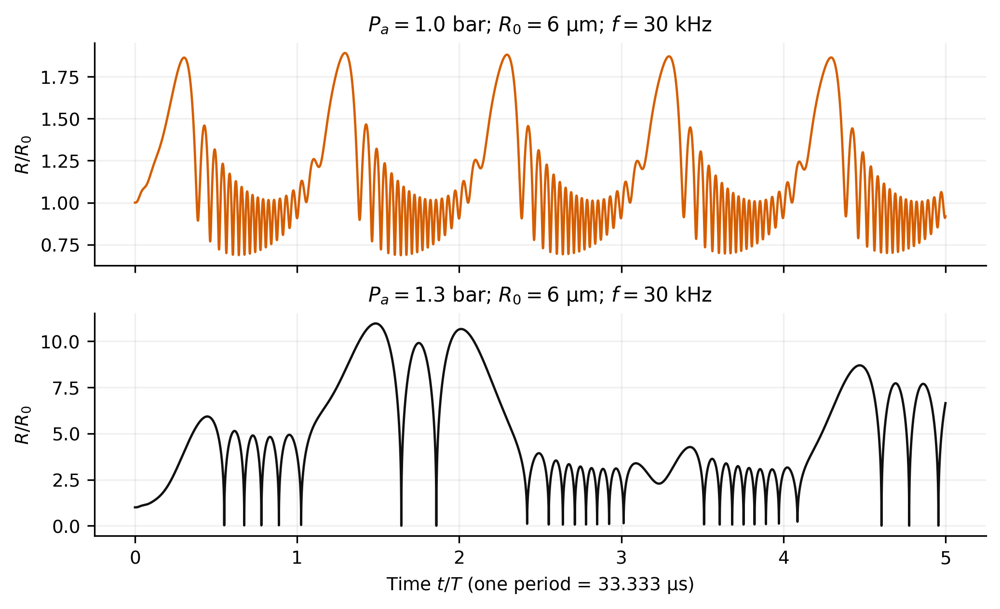</a>
  <a href="Mini_Research/02_Compressible_Bubble_Dynamics/figures/03_strong_collapse.png">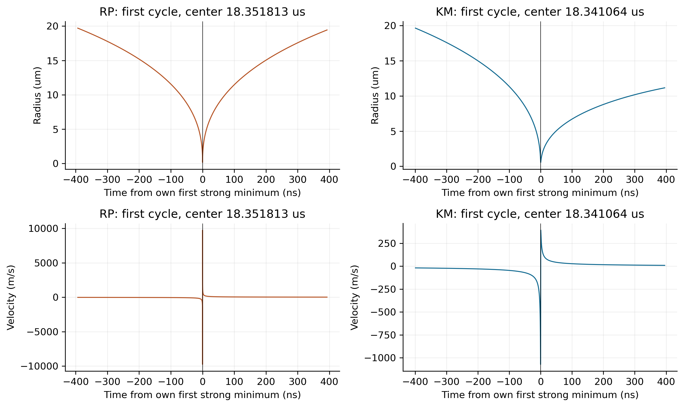</a>
</p>

*Left: initial RP radius trajectories. Right: the effect of liquid compressibility on strong-collapse events. Numerical resolution does not make the extreme RP trajectory physically valid.*

### B. From compression to gas temperature (MR3–MR4)

<p align="center">
  <a href="Mini_Research/03_In_Bubble_Thermodynamics/figures/02_radius_temperature.jpg">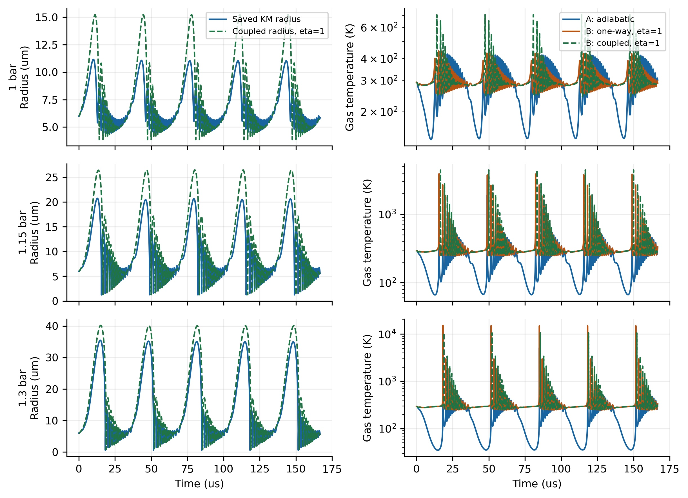</a>
  <a href="Mini_Research/04_Temperature_Barrier/figures/02_temperature_histories.jpg">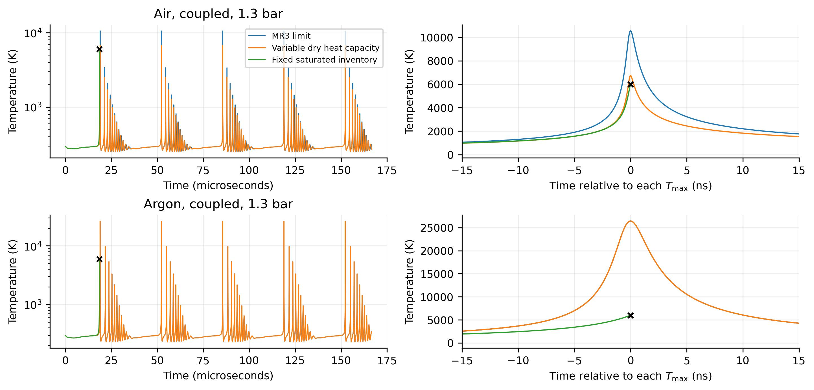</a>
</p>

*Pressure feedback, thermal loss, the gas mixture and variable heat capacity change peak-temperature estimates. Coefficient-censored curves are not extrapolated.*

### C. Plasmonic absorption and transient heating (MR5)

<p align="center">
  <a href="Mini_Research/05_Plasmonic_Heating/figures/02_optical_spectra.jpg">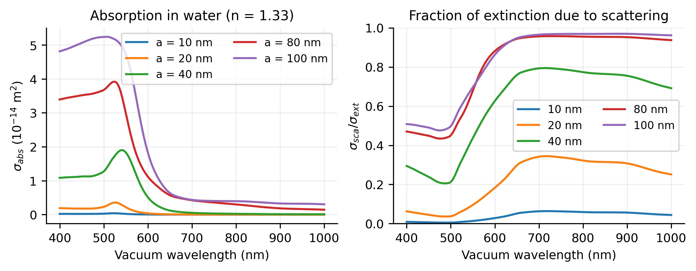</a>
  <a href="Mini_Research/05_Plasmonic_Heating/figures/06_pulse_heating.jpg">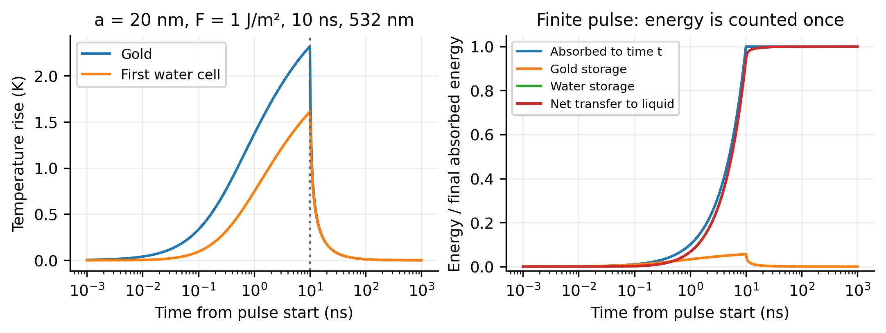</a>
</p>

*Absorption and scattering are not interchangeable, and the energy stored in AuNPs is not immediately delivered to water or gas.*

### D. Heat transfer near a bubble: resolved stationary geometry (MR6)

<p align="center">
  <a href="Mini_Research/06_AuNP_Bubble_Coupling/figures/01_geometry.jpg">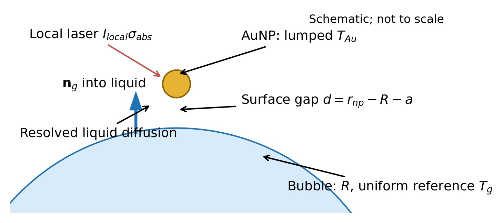</a>
  <a href="Mini_Research/06_AuNP_Bubble_Coupling/figures/02_local_temperature_flux.jpg">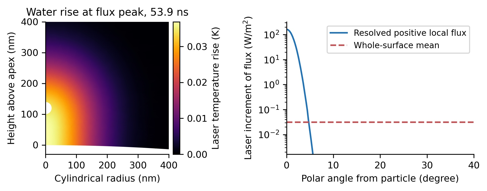</a>
</p>

*MR6 resolves a finite particle and local transfer to a stationary bubble, but does not establish delivery under a rapidly moving boundary.*

### E. Coupled moving system and thermal memory (MR7)

<p align="center">
  <a href="Mini_Research/07_Integrated_Model/figures/02_dynamics.jpg">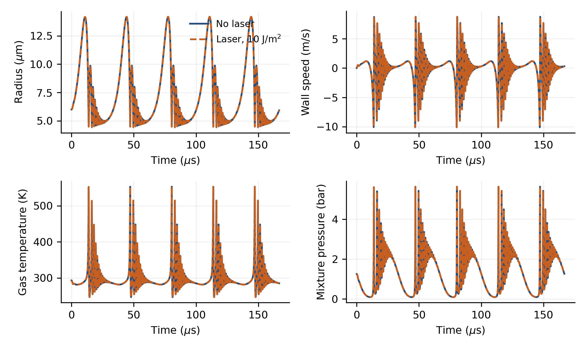</a>
  <a href="Mini_Research/07_Integrated_Model/figures/10_transport.jpg">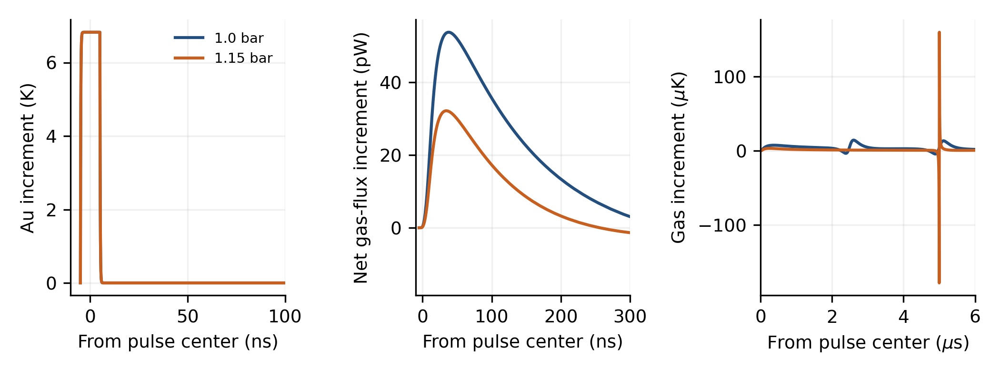</a>
</p>

*The laser and no-laser trajectories nearly overlap on the main scale. A transient temperature difference and the difference between separately maximized temperatures are not the same observable.*

### F. Extreme mechanics, timing, and favorable energy bounds (MR8)

<p align="center">
  <a href="Mini_Research/08_Physical_Feasibility/figures/02_mechanics.jpg">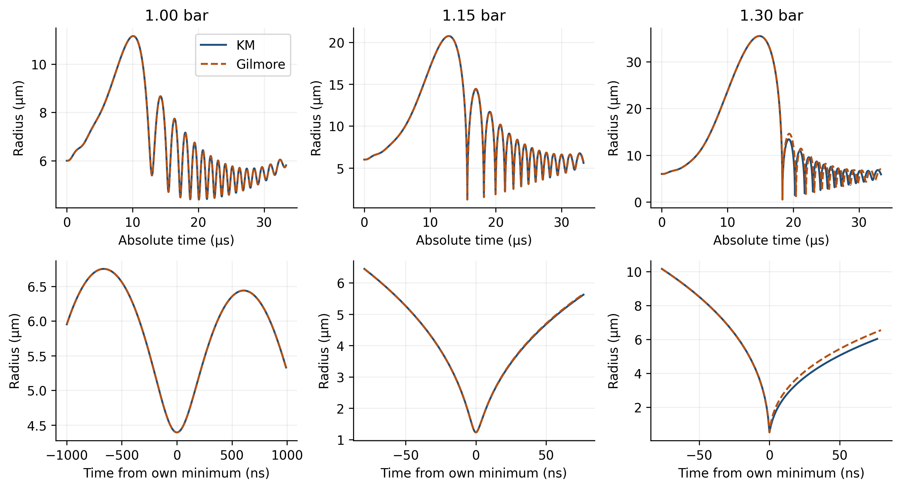</a>
  <a href="Mini_Research/08_Physical_Feasibility/figures/03_timescales.jpg">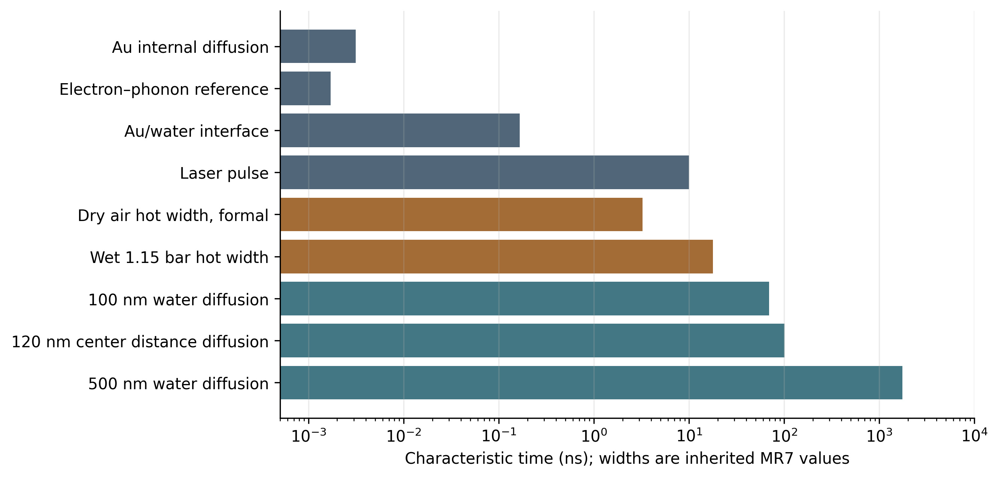</a>
</p>

*Changing the liquid equation of state changes a strong-collapse trajectory. Optical-pulse, thermal-transfer and gas-heating time scales must be distinguished.*

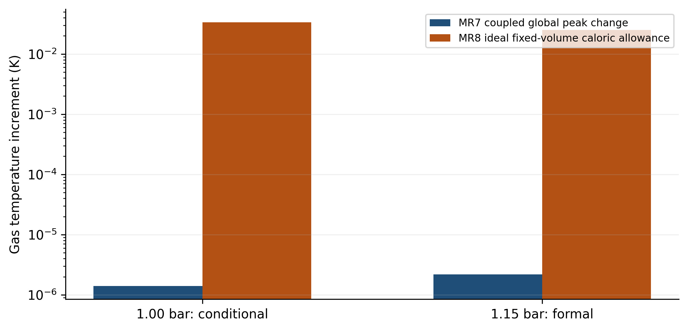

*Final synthesis: a deliberately favorable direct-caloric calculation and a coupled dynamic prediction answer different questions. Their difference does not define a universal heat-transfer efficiency.*

## 5. The eight Mini-Research studies

Each stage is accompanied by its own scientific PDF, code, tests, inputs, saved output and/or reproduction notes. The original plan calls them Parts A–H; the completed series uses the consistent names Mini-Research 1–8.

| Study | Scope and main deliverable | Read the paper | Code, data, and checks |
|---|---|---|---|
| **MR1** — Bubble Dynamics | Incompressible RP baseline, acoustic-radius sweeps, convergence and formal extremes | [MR1 PDF](Mini_Research/01_Bubble_Dynamics/report/mini_research_01.pdf) | [MR1 package](Mini_Research/01_Bubble_Dynamics/) |
| **MR2** — Compressible Bubble Dynamics | KM mechanics, RP comparison, correctly paired events and validity indicators | [MR2 PDF](Mini_Research/02_Compressible_Bubble_Dynamics/report/02_Compressible_Bubble_Dynamics.pdf) | [MR2 package](Mini_Research/02_Compressible_Bubble_Dynamics/) |
| **MR3** — In-Bubble Thermodynamics | Adiabatic, one-way and mechanically coupled gas-temperature models | [MR3 PDF](Mini_Research/03_In_Bubble_Thermodynamics/report/03_In_Bubble_Thermodynamics.pdf) | [MR3 package](Mini_Research/03_In_Bubble_Thermodynamics/) |
| **MR4** — Temperature Barrier | Variable heat capacity, fixed vapor inventory, coefficient domains, chemical energy scales | [MR4 PDF](Mini_Research/04_Temperature_Barrier/report/04_Temperature_Barrier.pdf) | [MR4 package](Mini_Research/04_Temperature_Barrier/) |
| **MR5** — Plasmonic Heating | Dipole/Mie optics, AuNP absorption and transient Au–water heating | [MR5 PDF](Mini_Research/05_Plasmonic_Heating/report/05_Plasmonic_Heating.pdf) | [MR5 package](Mini_Research/05_Plasmonic_Heating/) |
| **MR6** — AuNP–Bubble Coupling | Finite-Au stationary heat-transfer model, flux localization and static delivery windows | [MR6 PDF](Mini_Research/06_AuNP_Bubble_Coupling/report/06_AuNP_Bubble_Coupling.pdf) | [MR6 package](Mini_Research/06_AuNP_Bubble_Coupling/) |
| **MR7** — Integrated Model | Moving radial heat transport, laser/no-laser pairs, gas-pressure feedback and limitations | [MR7 PDF](Mini_Research/07_Integrated_Model/report/07_Integrated_Model.pdf) | [MR7 package](Mini_Research/07_Integrated_Model/) |
| **MR8** — Physical Feasibility | Gilmore–Tait mechanics, energy audit, idealized caloric allowances and final feasibility assessment | [MR8 PDF](Mini_Research/08_Physical_Feasibility/report/08_Physical_Feasibility.pdf) | [MR8 package](Mini_Research/08_Physical_Feasibility/) |

The synthesis of the complete program is in the **[Consolidated Final Scientific Report](Final_Report/Consolidated_Final_Scientific_Report.pdf)**. It can be read on its own; the individual reports provide derivations, figures, numerical evidence and detailed scope qualifications.

## 6. What is established—and what remains open?

### Established within the stated mathematical models

- A numerically tested hierarchy of spherical acoustic-bubble models with explicitly differentiated event definitions and coefficient-domain stopping rules.
- Thermodynamically consistent fixed-inventory gas energy and signed interface heat exchange in the declared closures.
- Mie/dipole optical calculations, transient AuNP heating, stationary finite-Au transfer and a reduced moving-water integrated model.
- Reproducible matched laser/no-laser temperature increments for the specified nominal experiment.
- A bounded, numerically checked **KM versus Gilmore–Tait** mechanical comparison at 1.00, 1.15 and 1.30 bar.
- A transparent classification of completed, censored, conditional, and physically formal extreme scenarios.

### Not established by the program

- **Experimental validation of the complete integrated laser–AuNP–bubble model.**
- A physically reliable *universal* upper bound on bubble-gas temperature.
- A validated mechanism for maintaining an AuNP at the prescribed near-wall separation throughout collapse.
- Local moving-boundary AuNP hot spots, phase change/nucleation, shock focusing or nonspherical collapse.
- Fully reacting, ionizing and nonideal dense-gas thermodynamics beyond the current fixed-mixture closures.
- A probability of rare favorable configurations, or a nuclear-fusion yield.

Other authors' **acid-based sonoluminescence emission temperatures** and **deuterated-acetone numerical predictions** are discussed in the final report only as context. They are neither matched measurements of this water/AuNP system nor experimental proof of thermonuclear reactions.

For a deuterium plasma the illustrative D–D reaction-count structure would be

$$
N_{\mathrm{DD}}=
\int \frac{1}{2}n_D(\mathbf x,t)^2
\langle\sigma v\rangle_{\mathrm{DD}}(\mathbf x,t)\,dV\,dt.
$$

This study does **not** specify a validated deuterium inventory, ion-temperature distribution, hot volume or hot-state lifetime; therefore it does **not** invent a reaction count, assign it zero, or claim a positive yield.

**Scientific conclusion:** the specified single-AuNP energy-transfer pathway has a very small modeled effect on the global gas-temperature maximum. It neither establishes the proposed fusion mechanism nor proves that all other rare physical hot regions are impossible. Those are distinct questions requiring additional evidence.

## 7. Reproducing the results

The repository retains source modules, parameter/data schemas, locked Python environments, tests, figure-generation scripts, LaTeX and published PDFs. Each Mini-Research directory has its own README and instructions.

**Quick path to the final study:**

```bash
git clone https://github.com/DimitriBolt/Plasma.git
cd Plasma/Mini_Research/08_Physical_Feasibility
python3.12 -m venv .venv
source .venv/bin/activate
python -m pip install -r requirements-lock.txt

# Check archived bytes before regenerating any files:
sha256sum -c SHA256SUMS

# MR8 bounded tests and published-source recomputation:
python -m unittest discover -s tests -v
python -m src.run
python -m src.presentation
```

The numerical MR8 runner performs **18 limited one-cycle mechanical integrations** and audits stored data. The complete repository checkout is needed for read-only imports from earlier stages. These commands do **not** repeat all historical, potentially expensive MR1–MR7 parameter sweeps.

Build the two English scientific reports with a working LaTeX/`latexmk` environment:

```bash
latexmk -pdf -interaction=nonstopmode -halt-on-error -cd report/08_Physical_Feasibility.tex
latexmk -pdf -interaction=nonstopmode -halt-on-error -cd ../../Final_Report/Consolidated_Final_Scientific_Report.tex
```

For numerical and publication details see:

- [MR8 reproducibility and validation](Mini_Research/08_Physical_Feasibility/results/validation.md)
- [MR8 data definitions and model assumptions](Mini_Research/08_Physical_Feasibility/results/data_schema.md)
- [MR8 primary-source audit](Mini_Research/08_Physical_Feasibility/results/source_audit.md)
- [Independent-reader assessment of the final report](Mini_Research/08_Physical_Feasibility/results/standalone_reader_test.md)
- [MR7 reproducibility instructions and compact public dataset](Mini_Research/07_Integrated_Model/README.md)
- [Original eight-stage research plan](Plasma-plan.tex)

**Reproducibility scope:** the final MR8 calculations and the compact published MR7 reference traces can be checked from a complete checkout. The approximately 1 GB historical full MR7 local archive was **not** published and is not required for the bounded MR8 reproduction. Published checksum manifests document the immutable archived bytes; regenerated PDFs and metadata need not be byte-identical across machines.

## 8. Repository map

```text
Plasma/
├── README.md                              ← project overview (this page)
├── Plasma-plan.tex                        ← original A–H research plan
├── Final_Report/
│   ├── Consolidated_Final_Scientific_Report.pdf
│   ├── Consolidated_Final_Scientific_Report.tex
│   ├── figures/                           ← selected scientific illustrations
│   └── README.md
├── Mini_Research/
│   ├── 01_Bubble_Dynamics/
│   ├── 02_Compressible_Bubble_Dynamics/
│   ├── 03_In_Bubble_Thermodynamics/
│   ├── 04_Temperature_Barrier/
│   ├── 05_Plasmonic_Heating/
│   ├── 06_AuNP_Bubble_Coupling/
│   ├── 07_Integrated_Model/
│   └── 08_Physical_Feasibility/
└── Library/                               ← background literature materials
```

The stage directories generally include a `report/` scientific PDF and LaTeX source, `src/` code, `results/` numerical tables/data and checks, `figures/`, tests, and `SHA256SUMS` where appropriate.

## 9. Credits and reading guidance

**Research and reports:** Dimitri Bolt  
**Academic supervisor:** Prof. Dr. Ildar R. Gabitov  
**Prepared for preliminary scientific discussion**, including with Prof. Dr. Hahn; he is an intended reader, not a coauthor or supervisor.

The project is an **eight-study completed modeling and feasibility assessment**. Its research title preserves the motivating hypothesis—*overcoming the temperature barrier*—but the scientific conclusion is narrower: the model and its limitations are documented; overcoming that barrier, a physical universal temperature limit, and thermonuclear sonofusion have **not** been demonstrated.

For a first reading, open the [**Consolidated Final Scientific Report**](Final_Report/Consolidated_Final_Scientific_Report.pdf). To inspect the actual equations, cross-checks or data, follow its section-specific links to the eight research packages.
